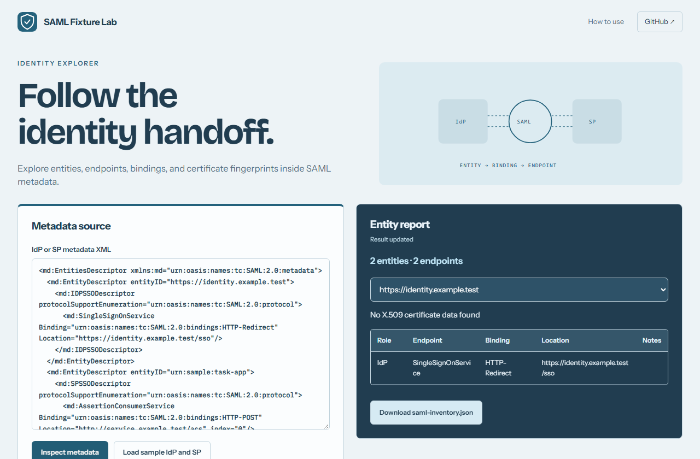

# SAML Fixture Lab

**Inspect SAML metadata.** List entity IDs, SSO and ACS endpoints, bindings, and certificate fingerprints from IdP or SP XML.

[Open the live tool](https://musabukhari237.github.io/saml-fixture-lab/) · [Report an issue](https://github.com/MusaBukhari237/saml-fixture-lab/issues)

[](https://musabukhari237.github.io/saml-fixture-lab/)

## Try the example

Load the sample with one IdP and one SP and inspect it. Select the service provider to see its ACS endpoint and the HTTP warning. Export the inventory as JSON.

## Data and limits

Accepts SAML metadata EntityDescriptor and EntitiesDescriptor documents. Flags missing fields, duplicate entity IDs, and non-HTTPS locations. Calculates SHA-256 fingerprints of the supplied certificate bytes. It does not validate the metadata signature, certificate trust, or protocol traffic.

See the [OASIS SAML metadata specification](https://docs.oasis-open.org/security/saml/v2.0/saml-metadata-2.0-os.pdf). An inventory identifies supplied endpoint and certificate data. Use your identity stack’s trust and signature checks before adopting metadata.

## Run locally

Clone the repo and serve the `docs` folder from localhost.

```sh
python -m http.server 8000 --bind 127.0.0.1 --directory docs
```

Open http://127.0.0.1:8000 in a current browser. Run `node --test` from the repository root with Node.js 22 or later.

## Interface

An identity-handoff illustration connects a light metadata editor to a navy entity report with selectable entities.

Use Ctrl+Enter or Command+Enter to run the current inputs. Clear editor clears pasted text, and View results moves keyboard focus to the output. Status text identifies changed inputs and refreshed results.

Fonts and imagery are bundled locally. Visual sources and font licenses are recorded in [asset credits](docs/Assets.md).

## Sponsors

Supported by [LeadCeleris](https://www.leadceleris.com/) and [AIFFICIENTO](https://www.aifficiento.biz/).

## Contributing

Read [CONTRIBUTING.md](CONTRIBUTING.md) and use synthetic fixtures in issue reports. The source is available under the [MIT license](LICENSE).
